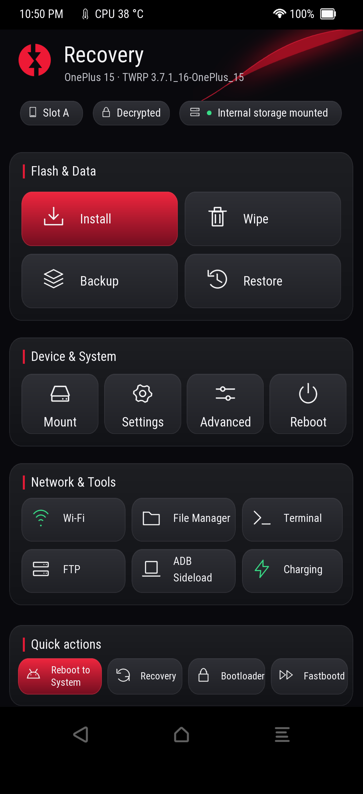

# TWRP device tree for ONEPLUS infiniti

## Supported devices

- OnePlus 15 all variants

## Modern recovery UI preview

The OxygenOS-style OLED-black/red dashboard uses native TWRP actions. The Wi-Fi
page shows signal strength and scan status; tapping a secured network opens the
password keyboard. Saved Wi-Fi profiles, the existing network tools, charging
controls and normal Backup/Restore menus are retained. Magisk 31.1 is bundled.

**Preview / known issue:** Adreno GPU composition is available, but intermittent
missing status characters or panel fills still occur. This is **not** a stable
GPU fix. The new build is a pre-release; the previous stable release remains
Latest. See the [test scope and release notes](docs/releases/2026-11-07-modern-ui-wifi.md).

<p align="center">
  
</p>

Live recovery screenshot from local testing. It illustrates the theme, not a
guarantee of artifact-free GPU rendering. No screenshot is bundled in the ramdisk.

## Build it yourself

```shell
mkdir twrp && cd twrp
repo init --depth=1 -u https://github.com/TWRP-Test/platform_manifest_twrp_aosp.git -b twrp-16.0
repo sync
git clone --depth=1 https://github.com/travismills82/twrp_device_oplus_infiniti device/oplus/infiniti
```

```shell
bash device/oplus/infiniti/scripts/select-recovery-source.sh
bash device/oplus/infiniti/scripts/apply-recovery-patches.sh
source build/envsetup.sh
lunch twrp_infiniti
m recoveryimage
```

If there is no error, `recovery.img` will be found in `out/target/product/infiniti/recovery.img`.

## Flash recovery

```shell
fastboot flash recovery_a recovery.img
```

Do not flash `recovery_b` with this recovery. It is preserved for the
payload-provided recovery image from official A/B updates, which must remain
matched with that slot's boot and AVB chain.

## Features

Works:

- [X] ADB
- [X] Display
- [X] GPU acceleration support
- [X] Decryption
- [X] Fastbootd
- [X] OTA Flash
- [X] MTP
- [X] Sideload
- [X] Touch
- [X] Double tap to wake
- [X] USB OTG
- [X] Vibrator
- [X] Wireless LAN Support
- [X] Bypass and SuperVooc charging support.
- [X] Interactive FTP/FTPS backup and restore unix menu
- [X] Cifs/SMB file manager
- [X] Interactive Cifs/SMB share backup and restore
- [X] Magisk installation built in to recovery 

## Charging controls

Open **Advanced > Charging** for native OnePlus bypass on/off, a charging status
report, and **Normal charging / Auto SUPERVOOC**. The same controls are available
with `twrp-charging status`, `twrp-charging bypass-on`, `twrp-charging bypass-off`,
and `twrp-charging auto` from the recovery terminal or a root recovery ADB shell.

Bypass uses the OnePlus PLC driver and requires a wired charger plus permission
from the driver's battery, temperature, and protocol checks. Recovery maintains
an explicitly requested active session across the driver's five-minute user
timeout; it clears its request if the cable is removed or the driver stops
bypass. Enable bypass again after reconnecting. The request is temporary and
is not saved across boots. Disable bypass to return control to normal charging.

The charging service supplies the native driver readiness handshake. Normal
charging removes a bypass request and enables the driver's charging vote;
SUPERVOOC then negotiates automatically with a compatible charger and cable.
The status report labels SUPERVOOC active only when both the wired connection
and VOOC charging state are active and the driver reports the SUPERVOOC protocol.
Adapter capability is not a measurement of actual charging power. Temperature,
current, voltage, authentication, and input-suspend protections stay under driver
control.

## Backup compression

When **Enable compression** is selected on the TWRP Backup options page, choose
either **Pigz (gzip, level 9)** or **Zstd (level 11, multithreaded)**. Pigz
remains the default and preserves compatibility with existing compressed `.win`
backups. Zstd archives are detected automatically by this recovery, including
encrypted file-based backups, but require this updated recovery to restore.

ADB backup streams remain gzip for compatibility with TWRP's existing ADB
backup protocol. Both local compression choices remain subject to the recovery
thermal guard.

### FTP Menu options

```text
1) Add FTP/FTPS server to ftp.conf
2) Select FTP/FTPS server from ftp.conf
3) Test selected server
4) Upload newest TWRP backup
5) List remote backup folder
6) Restore backup archive
7) Upload recovery log and network info
8) Show network info
9) Delete ftp.conf
0) Exit
```

On the home screen, the CIFS / SMB icon turns green when the native share is
mounted and connected. The FTP icon turns green only during a live FTP/FTPS
connection; choosing a saved server alone leaves it white. For a read-only
SMB mount diagnostic in Terminal, use `twrp-smb-mount status`.

## Decryption startup

Recovery releases its temporary stock vendor/ODM mounts before starting the
secure-element, OMAPI, Weaver, touch, and health services. The APEX-free build
uses ramdisk libraries without mounting stock vendor again for APEX setup.
`twrp-decrypt-prereqs` checks actual Binder registration with the packaged
`twrp-service-check`; absent services or a missing checker leave prerequisites
failed. Credential submission waits for the prerequisite sequence to finish.
Enter credentials only through the physical recovery GUI.
